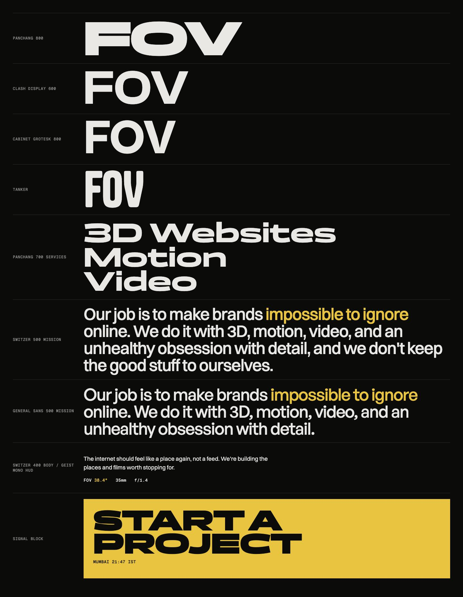
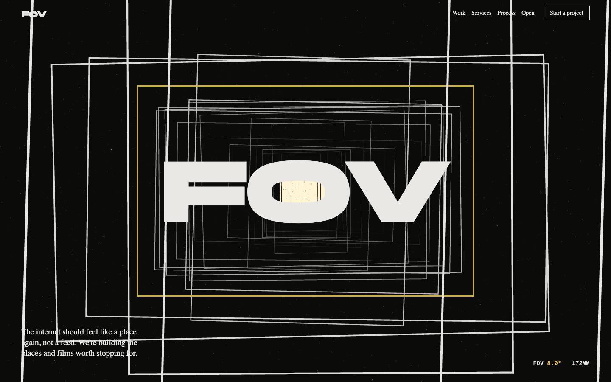
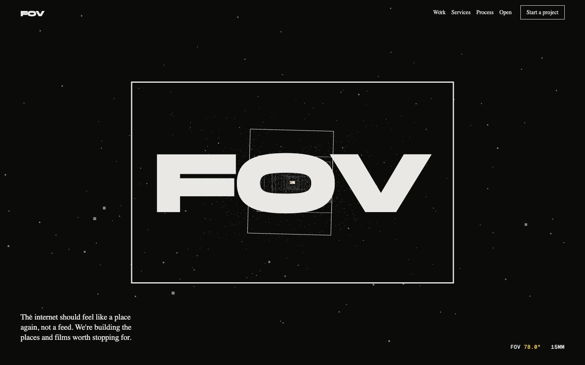
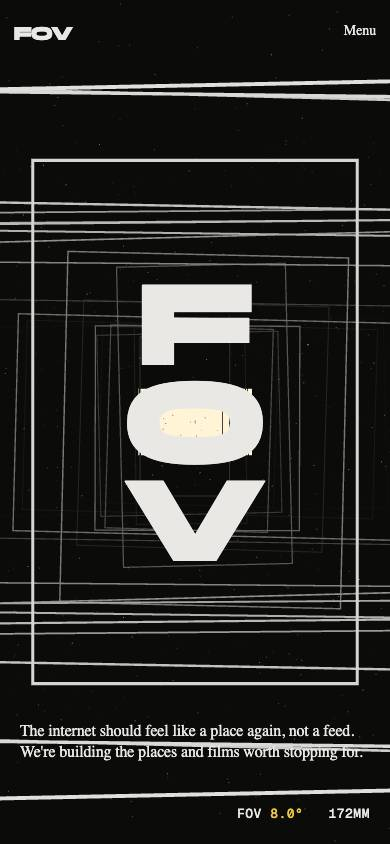
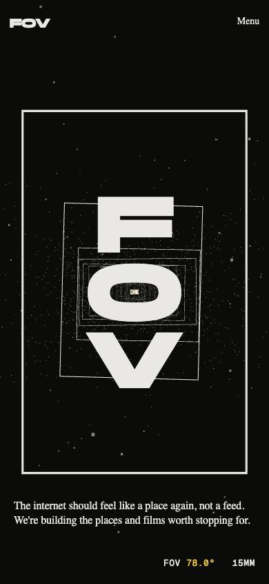

# FOV: Reference Research (Iteration 1)

Compiled 2026-10-10. This document feeds [DESIGN.md](./DESIGN.md). We extract **principles,
not copies**: no code, assets, layouts or copy from any reference is reused.

## Method

1. **Sources.** Awwwards site pages, case studies and Sites of the Month/Year listings; studio
   write-ups (Lusion blog, basement blog, Codrops); and the sites' own shipped HTML, CSS and JS,
   read for fonts, eases, durations and capability checks.
2. **Our own captures.** We drove each site with Playwright in headless Chromium: desktop at
   1440×900 (the first frame plus three wheel-scrolled states) and mobile at 390×844 (iPhone 13
   emulation, touch). We also fingerprinted each site's loaded fonts, canvases, libraries and
   framework. Sites that failed with software WebGL were re-captured with GPU-backed rendering.
   We keep the screenshots locally and do not commit them: they are other studios' work.
3. **Confidence tags.** **[S]** found in a source · **[O]** observed in our capture ·
   **[I]** our inference.

## 1. Reference index

| # | Site | By | Verified recognition | Why it's here |
|---|---|---|---|---|
| 1 | [lusion.co](https://lusion.co) | Lusion | SOTD 2 Oct 2023 + Dev (Animations 10.0), **Site of the Year 2023** [S] | Benchmark 3D studio; DOM-synced meshes |
| 2 | [immersive-g.com](https://immersive-g.com) | Immersive Garden | SOTD 7 Jan 2025, **SOTM Jan 2025** [S] | Restraint; 3D as material |
| 3 | [activetheory.net](https://activetheory.net) | Active Theory | V6: SOTD 6 Feb 2024 + Dev, **SOTM Feb 2024** [S] | Full-canvas site with capability tiers |
| 4 | [locomotive.ca](https://locomotive.ca) | Locomotive | SOTD 30 Mar 2023, **SOTM Mar 2023**; Agency of the Year 2024 [S] | Lenis lineage; restrained motion |
| 5 | [obys.agency](https://obys.agency) | Obys | New site: SOTD 4 May 2026 + Dev [S] | Framing as an interface; WebGL image planes |
| 6 | [dogstudio.co](https://dogstudio.co) | Dogstudio (DEPT) | SOTD 23 Apr 2019, **SOTM Apr 2019** [S] | One 3D subject carried through the whole scroll |
| 7 | [igloo.inc](https://www.igloo.inc) | abeto + Bureaux | SOTD 23 Jul 2024 + Dev; listed as **Site of the Year 2024** (category unverified) [S] | Scroll-driven camera journey |
| 8 | [unseen.co](https://unseen.co) | Unseen Studio | SOTD 6 Feb 2023 + Dev, **SOTM Feb 2023** [S] | Scenes as rooms, render-target transitions |
| 9 | [basement.studio](https://basement.studio) | basement | SOTD 25 Apr 2025 + Dev [S] | R3F 9 / React 19 stack, open-source site |
| 10 | [exoape.com](https://www.exoape.com) | Exo Ape | SOTD 23 May 2022 + Dev, **SOTM May 2022** [S] | Editorial DOM motion, scale of type |
| 11 | [landonorris.com](https://landonorris.com) | OFF+BRAND | SOTD 17 Nov 2025 + Dev, **Site of the Year 2025** (jury and Users' Choice) [S] | Current SOTY; one-accent palette; mobile craft |
| 12 | [phantom.land](https://phantom.land) | Phantom | SOTD 2 Jun 2025 + Dev [S] | Lens distortion; published motion numbers |

**Also reviewed:** [bruno-simon.com](https://bruno-simon.com) (SOTM Jan 2026),
[oryzo.ai](https://oryzo.ai) by Lusion (SOTM Apr 2026) and [lamalama.com](https://lamalama.com)
(SOTM Jul 2026). See §3.

---

## 2. Reference notes

### 1 · Lusion
- **Signature moment.** The homepage ends in a scroll-driven flight through black, then white,
  tunnels full of refracting diamonds. Scroll direction sets the speed, and press-and-hold slows
  time down [S]. The preloader is a black screen with the "L" mark and a giant `100` counter [O].
- **Type, grid, whitespace.** One family (Aeonik) plus IBM Plex Mono and a custom mono [S/O].
  A pale lavender ground, the hero 3D inset as a rounded card, small `+` corner marks, and
  generous margins. Work sits in a two-column grid with captions below the media [O].
- **Motion.** Mostly `cubic-bezier(.4,0,.1,1)` with UI durations of 0.1-0.6s. Expo and cubic
  eases plus a custom `ease.lusion` in JS. Custom virtual scroll with exponential wheel easing [S].
- **3D ↔ DOM.** A custom engine on three.js r158. Meshes are pinned to DOM rects (`syncDom`,
  `syncRect`) [S]. One fixed canvas runs behind the content [O].
- **Mobile.** A layout switch, lower-resolution textures, and convolution bloom off by default [S].
  The same 3D card renders on phones, with the headline above it [O].
- **We take:** DOM-synced 3D, so text stays HTML; letting the visitor operate time or the camera.
- **We leave:** the 0-100 counter and the "Play reel" split text.

### 2 · Immersive Garden
- **Signature moment.** A plaster-white 3D bas-relief that the type sits on [S/O], plus a
  "rapid scroll" cursor made of 120 dots that reads fast-scroll progress from the WebGL scene [S].
- **Type, grid, whitespace.** A serif (PS Times) at small sizes on a pale grey ground. Huge
  emptiness: the hero line is about 20px in a 1440px frame [O]. Proof that confidence can be quiet.
- **Motion.** SplitText line reveals: y 50→0 over 2s `power2.out`, opacity over 1.8s, 0.1s
  stagger. The hero fades over 1.2s `sine.inOut` [S].
- **3D ↔ DOM.** One persistent WebGL app that shows and hides a view per route [S/I], with DOM text
  on top.
- **Mobile.** `.glb` media are removed on phones and fewer media are shown per project [S].
- **We take:** pace. Long, slow reveals next to still moments. A persistent canvas with views.
- **We leave:** a near-invisible hero. Our name has to land in the first second.

### 3 · Active Theory
- **Signature moment.** A holographic-glass logo in a particle field. Work is a ring of 3D project
  planes. The current build includes AI chat and a WebMCP endpoint that lets agents query the
  site [S/O].
- **Type, grid, whitespace.** NB Architekt (wide technical caps) over a dark, glowing scene. A pill
  nav with "Work" and "Contact" joined by a line [O].
- **Motion.** Frame-rate-normalised lerp. The loop detects refresh rate (30-240Hz) and snaps to
  it [S].
- **3D ↔ DOM.** The whole page is a canvas with thin UI on top [S]. A headless browser without
  WebGL2 gets "Your browser is not supported" [O].
- **Mobile.** Capability tests scale bloom, lens streaks and particles (16k / 65k / 262k), and
  video textures become stills. A different camera FOV on phones [S].
- **We take:** capability tiers, and a different camera FOV per device.
- **We leave:** a hard "not supported" wall. We always serve a fallback.

### 4 · Locomotive
- **Signature moment.** Twenty-nine scanned staff walk and dance as low-poly characters in one
  canvas section [S]. A letter-shuffle loader [S].
- **Type, grid, whitespace.** A custom light display cut (PP Locomotive New) and Helvetica Now on a
  black/white palette [S].
- **Motion.** The team "avoided excessive animations and gadgets" [S]. Lenis 1.1.9 at default
  `lerp 0.1`, Barba transitions, GSAP `power4.out`, and CSS `cubic-bezier(.215,.61,.355,1)` [S].
- **3D ↔ DOM.** 3D is confined to one section that boots on view [S].
- **Mobile.** A separate hero video below 699px [S]. Reduced motion is barely handled [S].
  Our capture hit a Cloudflare challenge [O].
- **We take:** Lenis defaults are a proven feel. Spend 3D where it counts.
- **We leave:** ignoring `prefers-reduced-motion`.

### 5 · Obys (2026 site)
- **Signature moment.** A central strip of project images scrolls through a fixed pair of black
  bracket shapes. The image inside the brackets is the active project, and its name highlights in
  a left-hand index [O]. A Vertical / Horizontal / Grid switch rotates the WebGL image planes [S].
- **Type, grid, whitespace.** A custom neo-grotesk (Obys NG) at tiny sizes, pure white ground,
  and extreme whitespace around a single centred column [S/O]. The local time sits in the header
  [O].
- **Motion.** Movement over 1600ms with an exponential ease-out, opacity over 1000ms, exits over
  600ms. Virtual scroll with damping `log(0.91)` [S].
- **3D ↔ DOM.** Images are WebGL planes. The text is DOM [S].
- **Mobile.** The list loops and snaps (400ms, `cubic-bezier(.22,1,.36,1)`) and items reveal over
  1200ms [S/O].
- **We take:** framing as an interface. Long move durations (1.2-1.6s) for big moves.
- **We leave:** fixed central brackets. Our framing lives in the 3D frames and the cursor's
  autofocus box, so we never put a fixed bracket "viewfinder" over a gallery.

### 6 · Dogstudio
- **Signature moment.** One 3D dog, built over about two years, stays on screen through the whole
  site. Its pose and the colour of its light change per section [S/O].
- **Type, grid, whitespace.** GT Sectra Display headlines in large right-aligned stacks, with
  Heebo for body text [S/O]. Deep blue-violet atmosphere.
- **Motion.** easeOutQuart and easeOutExpo, 0.3-1.2s. Scroll progress maps to camera
  keyframes [S].
- **3D ↔ DOM.** A transparent canvas behind the DOM, matcap shading, no lights [S].
- **Mobile.** The dog becomes a static PNG on phones. All CSS motion is off on touch devices [S/O].
- **We take:** one subject carried through the entire scroll. For us, the subject is the camera.
- **We leave:** switching motion off entirely on phones. We downgrade instead.

### 7 · Igloo Inc
- **Signature moment.** An intro rendered live in the browser, then a scroll-driven camera
  journey through procedurally grown ice blocks, one per portfolio company. Particles form a
  different shape for each link [S]. A HUD of mono labels in every corner [O].
- **Type, grid, whitespace.** Pixel and mono HUD type over full-bleed cold grey 3D [O].
- **Motion.** Chromatic aberration, displacement and frost transitions. No eases published [S].
- **3D ↔ DOM.** All UI, including the text (SDF), is in WebGL [S]. Dev scores: Animations 9.6,
  Accessibility 6.6 [S].
- **Mobile.** Tuned for low-end devices, with shaders compiled during load [S]. Our 390px
  capture stayed on the loader [O].
- **We take:** the camera as the storyteller.
- **We leave:** text inside WebGL (it hurts SEO and accessibility) and decorative HUD clutter.
  Our readout shows one number pair, and both are real.

### 8 · Unseen Studio
- **Signature moment.** A sound gate ("Enter" / "Enter without audio") opens onto a surreal home.
  Projects are reached by "diving under the water" [S/O].
- **Type, grid, whitespace.** Neue Montreal with Saol Display (serif) [O]. A soft pink ground and
  a centred, tiny intro [O].
- **Motion.** Each page is its own scene in a render target, and one shader blends between them.
  Camera curves were authored in Blender [S].
- **Mobile.** Not documented. The gate appears on mobile too [O].
- **We take:** scenes as rooms with camera-move transitions, and one shader for the cut.
- **We leave:** entry gates. Nothing stands between the visitor and the work.

### 9 · basement.studio
- **Signature moment.** Point-and-click navigation inside a low-poly 3D copy of their office [S].
  A "HUMAN / MACHINE" toggle pill at the bottom of the screen [O].
- **Type, grid, whitespace.** Geist, Geist Mono and a custom face [S]. Big grotesk headlines on
  black, a dense logo wall, and service columns [O].
- **Stack.** Next 16, React 19, **R3F 9**, drei, Rapier, Tailwind, motion. No GSAP or Lenis [S].
  The site's repo is open source [S].
- **Mobile.** A "lightweight mirror" for the heavy lab experience [S].
- **We take:** confirmation that R3F 9 + React 19 is a production-grade SOTD stack. An open-source
  site is the purest form of "giving back".
- **We leave:** a logo wall (we don't have one yet) and dense copy blocks.

### 10 · Exo Ape
- **Signature moment.** A full-bleed photograph with a giant three-line headline ("Digital /
  Design / Experience") that scrolls up over the image. A work "overview mode" transition [S/O].
- **Type, grid, whitespace.** Lausanne at 250px with -11.5px tracking and 0.9 line height [O].
  Editorial asymmetric work layouts on white [O].
- **Motion.** Route-based transitions that give "a sense of location" [S]. Scroll-scrubbed image
  sequences for CGI [S].
- **Mobile.** The same headline system, scaled. Very consistent [O].
- **We take:** type scale as the hero device, and transitions that tell you where you are.
- **We leave:** another "Play [thumb] Reel" split headline.

### 11 · Lando Norris (Site of the Year 2025)
- **Signature moment.** The hero portrait is masked by the giant "L4" logo shape on neon lime. A
  signature draws itself over a scrolling headline. Helmets change in real time on scroll [S/O].
- **Type, grid, whitespace.** Mona Sans Variable (condensed caps) mixed with Brier [O], with
  accent words set in a serif. A topographic line pattern, a scattered photo collage, and one
  accent (`#D2FF00`) used everywhere [S/O].
- **Motion.** GSAP + ScrollTrigger + SplitText, Lenis, Rive, and a curtain-reveal page transition.
  Element shadows were dropped for compositing cost [S].
- **3D ↔ DOM.** A glTF helmet with 6-7 layered animations, depth-map parallax, shader masks [S].
- **Mobile.** Separately formatted 3D assets for iOS, and a rotate prompt where needed [S]. Mobile
  is fully designed, not shrunk [O].
- **We take:** one saturated accent used with total discipline. Mobile as a first-class
  composition.
- **We leave:** the mixed serif-in-sans emphasis. We emphasise with colour within one family.

### 12 · Phantom
- **Signature moment.** An infinite draggable grid of project tiles behind a **lens-distortion**
  and vignette pass, plus staff faces as about 78k particles driven by tiny depth-map WebPs [S/O].
  The local time is in the header [O].
- **Type, grid, whitespace.** Helvetica Now with Ballinger Mono for tile metadata. A black ground
  and a bottom pill nav [O].
- **Motion (published, via a scraped copy of the Codrops article).** Distortion from flat to
  curved over 1s `power2.out`. Camera z on press over 1s `cubic-bezier(.23,1,.32,1)`. Drag
  velocity lerps at 0.8 and decays at 0.1 per frame. Face transitions take 1.6s [S].
- **3D ↔ DOM.** GSAP drives both DOM and WebGL from one timeline system. A vanilla Three.js grid
  is mounted into R3F through `<primitive>` [S].
- **We take:** lens distortion as a velocity response. One animation engine for DOM and WebGL.
- **We leave:** a whole-site draggable grid. Our work section is short and curated.

---

## 3. Also reviewed

- **Bruno Simon (SOTM Jan 2026).** A driving-game portfolio on three r183 with WebGPU/TSL and
  Rapier. Menus are 3D objects [S]. Mobile gets an automatic lower preset [S]. *Lesson:* commit
  fully to one interaction model, and build quality presets in from day one.
- **Oryzo by Lusion (SOTM Apr 2026).** A satirical product launch told as a linear scroll story.
  Gaussian splats only where they pay off (props, reflections), and 43% fewer splats on
  mobile [S]. *Lesson:* hybrid rendering budgets; spend detail where the camera actually looks.
- **Lama Lama (SOTM Jul 2026).** A video-led studio portfolio rather than a 3D one, with
  scroll-synced video and an intro made from the logo animation [S]. *Lesson:* proof that video
  craft alone can win, which matters for FOV's video practice.

---

## 4. Cross-cutting principles (and what they mean for FOV)

1. **One idea, all the way through.** Every SOTY/SOTM here commits to a single device: a dog, an
   ice journey, an office, a helmet. → *FOV commits to the camera: widen, focus, lens, frame,
   pan, open, lights on.*
2. **One persistent canvas, with text in the DOM.** Lusion, Immersive Garden, Obys and Dogstudio
   all keep copy as HTML over or around one long-lived WebGL context. Sites that move text into
   WebGL (Igloo, Bruno) score about 6.6 on accessibility. → *One shared R3F canvas with drei
   `<View>`s. Every word stays HTML.*
3. **Scroll drives the scene; it doesn't trigger it.** All twelve smooth or virtualise scrolling
   and map progress, not time, to the camera. → *Lenis + ScrollTrigger scrub on every camera
   move.*
4. **Two speeds of motion.** Big moves take 1.2-2.0s with expo or quart ease-outs (Obys 1600ms,
   Immersive Garden 2s, Phantom 1-1.6s). UI feedback takes 0.2-0.6s. → *`lens` 0.9-1.2s for
   reveals, 0.25-0.5s for UI, `shutter` for cuts.*
5. **Smoothing beats long tweens.** Lerp and damping values of 0.1-0.25 on pointer and drag
   (Phantom, Active Theory, Lenis 0.1) create the "expensive" feel. → *Lenis `lerp 0.1`, cursor
   box `lerp 0.18`, camera parallax damped.*
6. **Fallbacks in steps, not walls.** Capability tests progressively drop bloom, particles and
   video textures. Phones get a designed preset (Active Theory, Bruno, Oryzo, Immersive Garden). →
   *Three quality tiers plus PerformanceMonitor, and a CSS fallback with identical content.*
7. **Restrained palettes, one accent.** Black/white plus at most one colour (Lando's lime, our
   yellow). → *Ink, paper and signal. Yellow means "in focus".*
8. **One or two type families, used at extreme scale contrast.** Exo Ape's 250px headline next to
   12px metadata; Obys's tiny UI against full-bleed imagery. → *Panchang at display sizes only,
   Switzer for words, Geist Mono for data.*
9. **Mobile is composed, not shrunk.** Lando and Exo Ape re-compose for portrait. → *A stacked
   F / O / V wordmark inside a portrait subject frame (prototype below).*
10. **Accessibility is the field's weakest score.** It is the lowest Dev Award sub-score in every
    documented case, and reduced motion is barely handled. → *An opportunity to stand out:
    a reduced-motion mode that keeps the experience, keyboard parity for the cursor box, and AA+
    contrast everywhere.*
11. **Giving back is becoming a feature.** basement open-sourced its site, Immersive Garden hides
    "Backstage" breakdowns, and Active Theory exposes WebMCP tools to agents. → *Our "Open"
    section explains our own signature trick, live.*

## 5. Patterns we're avoiding (overused in this cohort)

| Pattern | Seen at | Our alternative |
|---|---|---|
| Giant 0-100 loading counter | Lusion, Immersive Garden | Load progress drives a focus pull on the wordmark |
| "Play [thumbnail] Reel" split headline | Lusion, Exo Ape | No reel in iteration 1; video shown in the work frames |
| Entry gate / "Click to start" / sound gate | Unseen, Bruno Simon | No gate; the site works on the first wheel tick |
| HUD clutter in every corner | Igloo | One live readout, and only real numbers |
| Fixed bracket viewfinder over a gallery | Obys | Framing lives in the 3D frames and the cursor's autofocus box |
| "Scroll to explore" cues | Lusion, Immersive Garden | None; the dolly zoom responds immediately |
| Text inside WebGL | Igloo, Bruno Simon | All copy in the DOM |
| Logo walls | basement | None until there's real client work to show |

## 6. Numbers worth keeping

| Source | Value |
|---|---|
| Lenis default (Locomotive, Immersive Garden) | `lerp 0.1` |
| Obys move / fade / exit | 1600ms expo-out / 1000ms quad-out / 600ms |
| Obys mobile reveal | 1200ms `cubic-bezier(.16,1,.3,1)` |
| Immersive Garden line reveal | 2s `power2.out`, stagger 0.1s |
| Phantom distortion / press | 1s `power2.out` / 1s `cubic-bezier(.23,1,.32,1)` |
| Lusion UI | 0.1-0.6s `cubic-bezier(.4,0,.1,1)` |
| Dogstudio | 0.3-1.2s easeOutQuart / easeOutExpo |
| Active Theory particle tiers | 16k / 65k / 262k |
| Oryzo splats, mobile vs desktop | 44,683 vs 78,233 (about 43% fewer) |

## 7. Our own exploration

**Type specimen** (Panchang 800, Clash Display, Cabinet Grotesk, Tanker; Switzer vs General
Sans; Geist Mono; signal block). Panchang won the wordmark because its extreme width reads as a
widescreen frame.

**Dolly-zoom prototype** (three.js r186 with the DOM wordmark on top; source in
`assets/proto-dolly.html`). The subject frame stays the same size from 8° to 78° while the tunnel
goes from a flat nested-frame graphic to deep perspective. A happy accident to keep: the far
"window" sits inside the counter of the **O**, which then reads as a lens.

| 8° (171mm) | 30° (45mm) | 78° (15mm) |
|---|---|---|
|  |  |  |

| Mobile 8° | Mobile 78° |
|---|---|
|  |  |

**Prototype findings that feed DESIGN.md:**
- At 8°, frames *in front of* the subject turn into large, chaotic overlapping rectangles. Front
  frames need less rotation jitter, fewer instances and a near-plane fade.
- At 78° the tunnel is too sparse. It needs more frames near the subject and larger near frames,
  so the wide lens reads as a corridor around you.
- A horizontal wordmark can't sit inside a portrait subject frame. On portrait the wordmark
  **stacks F / O / V** inside a vertical frame, which tested well and reads as a deliberate
  poster.

## 8. Sources

- Awwwards: [lusion-v3](https://www.awwwards.com/sites/lusion-v3) ·
  [immersive-garden-website](https://www.awwwards.com/sites/immersive-garden-website) ·
  [active-theory-v6](https://www.awwwards.com/sites/active-theory-v6) ·
  [locomotive-r](https://www.awwwards.com/sites/locomotive-r) ·
  [obys-2](https://www.awwwards.com/sites/obys-2) ·
  [dogstudio-1](https://www.awwwards.com/sites/dogstudio-1) ·
  [igloo-inc](https://www.awwwards.com/sites/igloo-inc) ·
  [unseen-studio](https://www.awwwards.com/sites/unseen-studio) ·
  [basement-studio-3](https://www.awwwards.com/sites/basement-studio-3) ·
  [exo-ape](https://www.awwwards.com/sites/exo-ape) ·
  [lando-norris](https://www.awwwards.com/sites/lando-norris) ·
  [phantom-land](https://www.awwwards.com/sites/phantom-land) ·
  [brunos-portfolio](https://www.awwwards.com/sites/brunos-portfolio) ·
  [oryzo-ai](https://www.awwwards.com/sites/oryzo-ai) ·
  [lama-lama-2](https://www.awwwards.com/sites/lama-lama-2) ·
  [annual awards winners](https://www.awwwards.com/annual-awards/winners) ·
  [Sites of the Month](https://www.awwwards.com/websites/sites_of_the_month/)
- Case studies: [Immersive Garden](https://www.awwwards.com/case-study-immersive-gardens-new-website.html) ·
  [Locomotive](https://www.awwwards.com/case-study-reinventing-locomotive-r.html) ·
  [Igloo Inc](https://www.awwwards.com/igloo-inc-case-study.html) ·
  [The new Obys](https://www.awwwards.com/the-new-obys.html) ·
  [Bruno Simon](https://www.awwwards.com/brunos-portfolio-case-study.html) ·
  [Unseen SOTM](https://www.awwwards.com/unseen-studio-by-unseen-studio-wins-sotm-february-2023.html) ·
  [Exo Ape SOTM](https://www.awwwards.com/exo-ape-wins-site-of-the-month-may-2022.html)
- Studio write-ups: [basement: new digital HQ](https://basement.studio/post/new-digital-hq-pt-1) ·
  [Lusion: Oryzo BTS pt 2](https://blog.lusion.co/oryzo-bts-part-2-7-3d-design-and-motion-graphics) ·
  [Lusion: Oryzo BTS pt 3](https://blog.lusion.co/oryzo-bts-part-3-7-website-ux-ui-and-illustrations) ·
  [Codrops: Phantom](https://tympanus.net/codrops/2025/06/30/invisible-forces-the-making-of-phantom-lands-interactive-grid-and-3d-face-particle-system/) ·
  [Codrops: Exo Ape](https://tympanus.net/codrops/2026/02/09/exo-ape-crafting-unforgettable-digital-journeys/) ·
  [OFF+BRAND: Lando Norris](https://itsoffbrand.com/our-work/lando-norris)
- Licences: [Fontshare licences (ITF FFL v2.0)](https://www.fontshare.com/licenses/itf-ffl)
